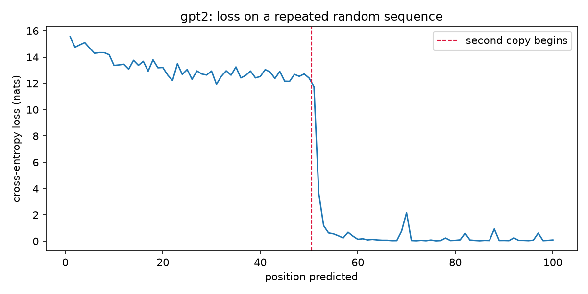
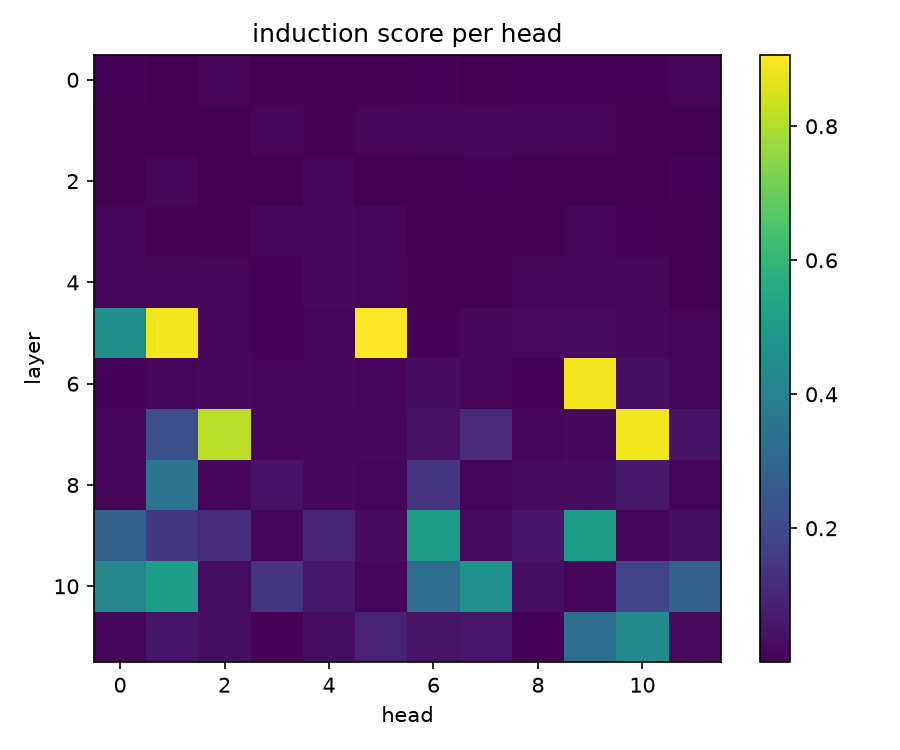
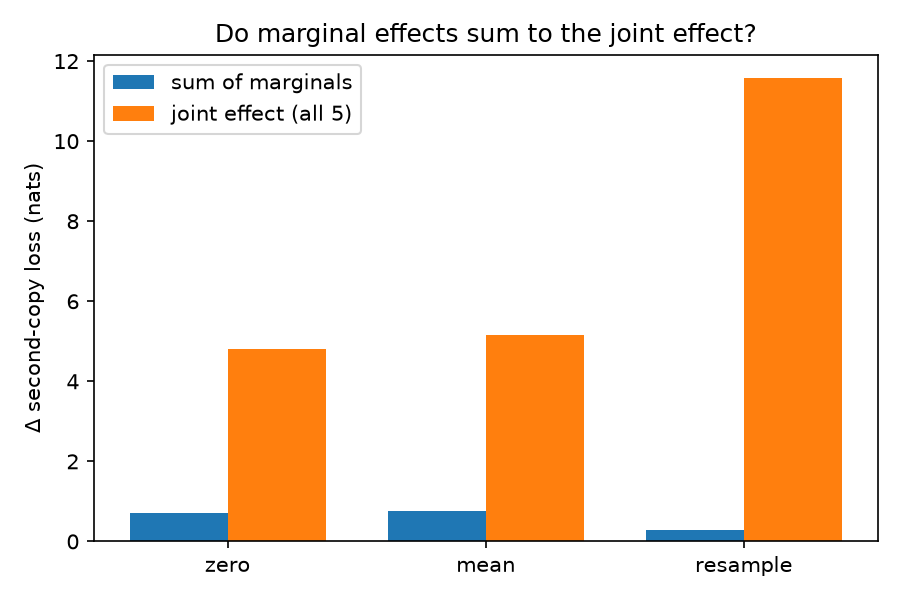
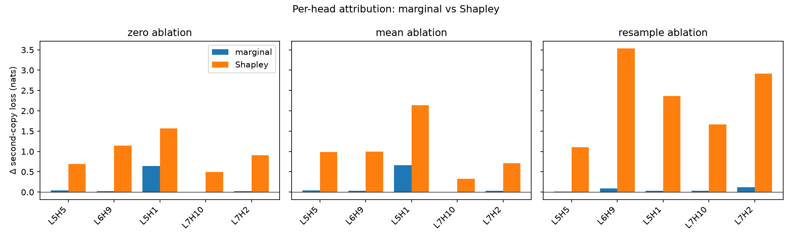

# Are attention head contributions additive?

A Shapley analysis of induction-head ablations in GPT-2 small.

**Status:** experiments 1–3 and two controls, run in that order. The second
control changed how experiment 2 should be read, and the text below has been
corrected accordingly rather than rewritten to look like it was right the first
time.

---

## The question

Single-head ablation is the standard way to ask what an attention head
contributes to a behaviour. It measures each head's *marginal* effect, holding
everything else fixed. But if heads compose — and induction heads sit in
different layers, so they can — marginal effects need not sum to the joint
effect. Whatever is left over is interaction, and single-ablation studies discard
it by construction.

I came to this from computational neuroscience, where I use counterfactual
intervention plus Shapley decomposition to attribute physiological effects across
parameters of a circuit model. There the joint nonlinearity was near zero and the
marginal and Shapley attributions coincided. I did not expect that to hold in a
transformer, and wanted to measure it rather than assume it.

That is the whole of what I set out to do. What follows is what happened.

## Experiment 1 — replication

Prompt the model with `[BOS] + S + S`, where `S` is 50 uniformly random tokens.
The first copy is unpredictable by construction; the second is perfectly
predictable given the ability to look back at the previous occurrence of the
current token and copy what followed it.



| | mean loss (nats) |
|---|---|
| first copy | 13.183 |
| second copy | 0.536 |

Scoring every head by the attention it places on the induction offset diagonal
recovers the expected heads:



**L5H5 · L6H9 · L5H1 · L7H10 · L7H2** — matching the heads reported for GPT-2
small elsewhere. This is a replication and confirms the measurement works. It is
not a finding.

## Experiment 2 — ablation and Shapley

All five heads ablated individually and across all 32 subsets. `v(S)` = mean
cross-entropy on second-copy positions with the heads in `S` ablated; the
attributed quantity is `v(all) − v(none)`. Shapley computed exactly, not sampled.
Σφ equals the total effect in every condition, as the efficiency axiom requires.

Three ablation counterfactuals, because "ablate a head" is underspecified:
**zero** (output → 0), **mean** (output → its batch mean), **resample** (output →
that head's output on a different sequence). I ran three rather than picking one
because of the replacement-versus-shift problem from my circuit-model work, where
two reasonable-looking counterfactuals assigned the same effect to opposite
mechanisms.



| ablation | Σ marginals | joint effect | interaction share |
|---|---|---|---|
| zero | +0.72 | +4.80 | 85.0% |
| mean | +0.76 | +5.16 | 85.2% |
| resample | +0.29 | +11.59 | 97.5% |

Removing any one induction head is close to harmless; removing all five is
catastrophic. My prediction that the contributions would not be additive was
right.

**I first wrote this up as "85% of the effect is interaction". Control 2 below
shows that was premature — the figure is metric-dependent and drops to 23% under
a more linear measure.** The percentages here are cross-entropy figures and
should be read as such.

Two other things fell out of the same run:

**Attention and causal importance disagree.** L5H5 has the highest induction
score in experiment 1 and a marginal ablation effect of +0.05 nats. L5H1, third
by attention, carries most of the marginal signal.



**The counterfactual changes the answer.** Resample gives a joint effect 2.4×
zero ablation and promotes a different head to the top of the Shapley ranking.

## Experiment 3 — the other half of the circuit

An induction head cannot work alone: something must first write "my previous
token was X" into the residual stream, and that is a **previous-token head** in an
earlier layer. Scoring all heads at offset `−1` finds them, and the layer ordering
matches the mechanism — previous-token heads in layers 2–4, induction heads in
5–7. Write before read.

This part is confirmatory. I predicted early-layer previous-token heads and found
them; the prior was high and it could barely have come out otherwise.

The one thing in it I did not already know is the shape of the distributions.
Previous-token is a single isolated spike — **L4H11 at 0.989**, next 0.541 —
while induction is five heads bunched at 0.81–0.91. That suggested a prediction
that *could* fail: if L4H11 has no real backup, ablating it alone should break
induction.

**It did not.**

| ablation | L4H11 | control head | best single induction | all 5 induction |
|---|---|---|---|---|
| zero | +0.250 | +0.009 | **+0.612** | +4.787 |
| resample | **+0.736** | −0.001 | +0.116 | +11.525 |

L4H11 costs less than the best single induction head under zero ablation, and
more under resample. The causal link is real but partial: with L4H11 zeroed,
induction scores fall (L5H1 0.889 → 0.537) while a matched control leaves them
untouched.

Removing previous-token capacity cumulatively, strongest first, with a matched
control at every step, produced continuous erosion and no threshold:

| | k |
|---|---|
| induction score halved | 5 |
| below 0.2, and loss halfway to no-information | 11 |
| below 0.1 | 15 |

The role is spread across roughly 11–16 heads. **Validity stops at k ≈ 19**, where
the matched control also begins destroying induction.

## Two controls

### Control 1 — is a head's importance a property of the head?

At k = 7 the sweep jumped +2.5 nats when L2H9 was added, the largest single step
anywhere, from a head ranked only seventh. Head, or position?

Ablated alone, **L2H9 costs +0.065 nats**. Across eleven ablation orderings the
big jump lands anywhere from k = 6 to k = 12, with L2H9 responsible in one of
them. It was redundancy exhaustion.

The same sweep showed something I had not been looking for: **L4H11 costs +0.250
nats ablated first and +5.23 nats ablated last.** Same head, factor of twenty,
depending only on what had already gone.

### Control 2 — how much of the interaction is the logarithm?

Cross-entropy is logarithmic, and log-loss is superadditive even for independent
contributions: while enough probability survives on the correct token the loss
hardly moves, and only when it collapses does it explode. The circuit-model
comparison I had been drawing measured firing rate, which is roughly linear — so
the two were never on the same footing.

Same 32 subsets, same Shapley, three measures from one forward pass:

| metric | joint | Σ marginals | interaction share |
|---|---|---|---|
| cross-entropy | 4.787 | 0.696 | **85.5%** |
| probability of correct token | 0.613 | 0.333 | **45.7%** |
| centred logit | 9.004 | 6.918 | **23.2%** |

The efficiency axiom holds for all three, so each decomposition is internally
correct; what differs is what is being decomposed.

The interaction is real — 23% under the most linear measure, against roughly zero
in the circuit model — but the 85% headline was substantially a property of
measuring in log space. This control should have been run before experiment 2 was
written up.

## Where this ended up

The question was whether contributions are additive. They are not, and that much
held up. But three side observations accumulated along the way, none of which I
went looking for:

| | |
|---|---|
| counterfactual (zero vs resample) | joint effect 2.4×, top-ranked head changes |
| metric (cross-entropy vs centred logit) | interaction share 85% → 23% |
| context (ablated first vs last) | same head, 0.25 → 5.23 nats |

Head redundancy itself is already documented — backup heads and self-repair are
known, and finding them again is not a contribution. Whether the sensitivity
above is news to people who do this professionally, I do not know. It was news to
me, and it is the reason the numbers in this repo are all reported with the
choices that produced them attached.

## Running it

Environment notes are in `requirements.txt` — install order matters, since
`transformer-lens` will otherwise pull a CPU-only torch.

```bash
python -m venv .venv
.venv/Scripts/activate                  # Windows
pip install torch==2.5.1 --index-url https://download.pytorch.org/whl/cu121
pip install transformer-lens matplotlib
python 01_induction_replication.py
python 02_ablation_shapley.py
```

Experiment 3 and both controls live in
[`01_induction_annotated.ipynb`](01_induction_annotated.ipynb), a step-by-step
walk-through built for inspecting intermediate tensors rather than just final
numbers. It uses `BATCH=32` where `02_ablation_shapley.py` uses 64, so figures
differ slightly between the two.

## Caveats

In [NOTES.md](NOTES.md), along with a control I got wrong the first time. The ones
that matter most: resample ablation injects wrong information rather than
removing information and probably overstates; everything is a single seed with no
error bars; and the five heads were selected by a correlational metric that this
work itself shows to be unreliable.

## References

The induction-head phenomenon and the replication setup follow Olsson et al.,
*In-context Learning and Induction Heads* (2022), and the transformer-circuits
framing of Elhage et al., *A Mathematical Framework for Transformer Circuits*
(2021). Tooling is [TransformerLens](https://github.com/TransformerLensOrg/TransformerLens).
